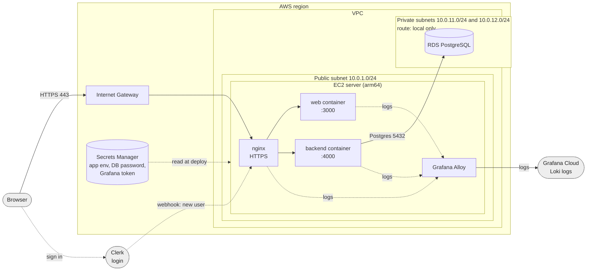

# Wild Workout

A small app for booking training sessions. Trainers set the hours they are free, attendees book one of those hours and pay with credit (a new attendee starts with 20 credit).

## Tech stack

| Part | What we use |
| --- | --- |
| Backend | Go, Echo, pgx, sqlc. A modular monolith with three modules: `users`, `trainers`, `trainings` |
| Frontend | Vite, React 19, TanStack Router and Query, Tailwind 4, shadcn/ui |
| Login | [Clerk](https://clerk.com). The backend checks the Clerk token and a Clerk webhook creates our users |
| Database | PostgreSQL (Docker on your machine, Amazon RDS in production) |
| API contract | OpenAPI files in `api/openapi/`. Both the Go code and the TypeScript types are generated from them |
| Infra and CI | Terraform, Docker, GitHub Actions |
| Logs | Grafana Alloy sends logs to Grafana Cloud (Loki) |

## Architecture on AWS

Everything runs in one VPC. One small EC2 server runs the app, and the database sits in private subnets that the internet cannot reach.



In short:

- **Entry point:** the browser reaches nginx on the EC2 server. nginx handles HTTPS (certificates from certbot) and forwards the app host to the web container and the API host to the backend container.
- **Database:** the backend talks to RDS PostgreSQL in the private subnets. Only the EC2 server is allowed to connect to it.
- **Secrets:** passwords and keys live in AWS Secrets Manager. On every deploy the script `deployment/write-backend-env.sh` rebuilds `backend.env` from them.
- **Deploy:** GitHub Actions builds the images and pushes them to GHCR. The manual workflow `.github/workflows/deploy.yml` then rolls the chosen version out to the server through AWS SSM.
- **Infrastructure as code:** `terraform/prod` uses the modules `vpc`, `ec2`, `rds` and `ssm` (Secrets Manager).

## Logs in Grafana

```
backend + web containers ─┐
                          ├─> Grafana Alloy (on the EC2 server) ─> Grafana Cloud Loki ─> Grafana
nginx access/error logs  ─┘
```

Alloy runs on the server, reads the Docker and nginx logs, adds labels and sends them to Grafana Cloud. In Grafana open **Explore**, pick the Loki data source and try:

```logql
{service="wild-workout-backend"}               # backend logs
{service="wild-workout-backend"} |= "error"    # only lines with "error"
{job="nginx", stream="error"}                  # nginx errors
{env="production"}                             # everything
```

Labels you can filter on:

| Label | Meaning |
| --- | --- |
| `job` | `docker` for containers, `nginx` for nginx files |
| `service` / `container` | the compose service and container name |
| `stream` | `access` or `error` (nginx only) |
| `env` | always `production` |

One-time setup: create a Grafana Cloud token, then run `terraform/prod/scripts/set-grafana-secret.sh` to store it in Secrets Manager and run the deploy workflow. The Alloy config is `terraform/modules/ec2/files/alloy.config.tftpl`.

## Run it locally

You need Docker and Node.

```bash
cp backend/.env.example backend/.env   # then fill in the Clerk keys
cp web/.env.example web/.env           # add your Clerk publishable key
make up                                # backend on :4000 and Postgres on :5432
make seed                              # sample trainer, attendee and open hours
make web                               # frontend on http://localhost:3000
```

Stop with `make down` (`make down-clean` also wipes the database).

## Project layout

```
backend/      Go API
web/          React app
api/openapi/  API specs (source of the generated code)
terraform/    AWS infrastructure
deployment/   production docker compose and deploy scripts
```

